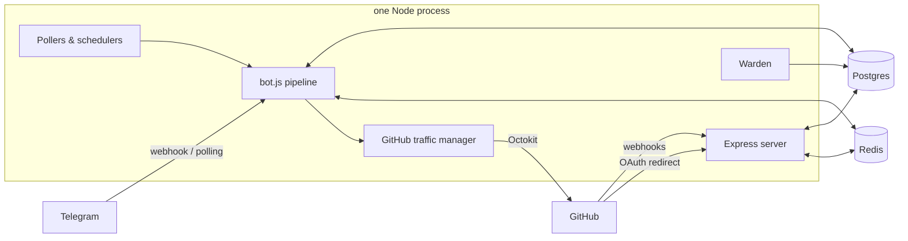

<div align="center">


# GitroHub

<h3>Your whole GitHub, from a Telegram chat.</h3>

Create, upload, edit, organise, back up and clean up repositories — safely, from your phone.

[](./CHANGELOG.md)
[](./package.json)
[](#quick-start)
[](#architecture)

[**Quick start**](#quick-start) · [**Features**](#features) · [**Architecture**](#architecture) · [**Operations**](#operations) · [**Security**](#security) · [**Changelog**](./CHANGELOG.md)

</div>

---

## 📖 Contents
1. [What is GitroHub?](#what-is)
2. [Features](#features)
3. [Quick start](#quick-start)
4. [Configuration](#configuration)
5. [Using the bot](#using)
6. [Architecture](#architecture)
7. [Operations](#operations)
8. [Security & privacy](#security)
9. [Testing & tooling](#testing)
10. [Project layout](#layout)
11. [Design principles](#principles)
12. [Known limitations](#limitations)
13. [Ideas for what's next](#next)

---

<a id="what-is"></a>

## 🚀 What is GitroHub?

GitroHub is a **multi-user Telegram bot** that turns chat messages and button taps into real actions on GitHub. Each person connects their own GitHub account through GitHub's normal login page; after that the bot can create repos, upload files and ZIPs, edit and browse files, tag and pin repos, run bulk clean-ups, schedule work for later, keep a safety-net Trash of everything you delete, and tell you when something happens on your repos.

It is built to be run for *many* people by one operator: every person's data and GitHub traffic are isolated, everything is rate-limited and bounded, and a fleet **Admin Dashboard** (role-based) lets the operator keep it healthy.

> [!TIP]
> New here? Read **[Quick start](#quick-start)** to deploy your own, or open the bot and send `/help` — the in-bot guide covers every feature.

---

<a id="features"></a>

## ✨ Features

### 📁 Repos & files

| | |
|---|---|
| **My Repos** | List, filter (language · tag · visibility · forks), sort, search, pin and tag the repos of the **active owner** — you, or an organisation you picked in 💼 Workspace → Organisations (never a mix). |
| **Create** | Name, description, visibility, licence, `.gitignore`, optional starter template (Node, Python, static HTML), README on/off — create now or **schedule** it. |
| **Upload** | Files or ZIP/TAR archives into any folder, with a **New / Modified / Unchanged preview** (line diff for text) before one atomic commit. **Replace Folder** syncs a folder, showing exactly what will be deleted. Executable bits survive overwrites. |
| **Browse & edit** | Walk folders, preview text and images, send any file (≤ 50 MB), **edit text files in chat** (message or uploaded file, newline style preserved, +/− preview, conflict-safe). |
| **Repo actions** | Visibility, licence, rename (carries tags, pins, alerts and schedules along), download as ZIP, delete. |
| **Search the world** | Paste a `github.com/…` link: download a public repo or fork it. |

### ⚡ Manage a repo (new in 1.2.4)

Every repo has a **⚡ Manage** hub. Each area is paged, confirms anything risky, and can be switched off by an admin (Global Config → 🧩 Feature Switches).

| | |
|---|---|
| **🔀 Pull requests** | List open/closed, read a PR with its files, comments and reviews; **merge / squash / rebase**, close, reopen, approve, request changes, comment, update branch; **create a PR from any branch**. |
| **🐞 Issues · 🎯 Milestones** | List, create, comment, close (completed / not planned) and reopen; **labels** (add, remove, create), **assignees**, milestones (create, assign, close, delete). |
| **🌿 Branches** | List, create, rename, delete, **set default**; **📍 work on a branch** (Browse, Upload and Edit then use it); **🔒 protection rules** that never reset the other rules; **🔄 fork sync** (fast-forward only). |
| **📜 Commits** | Browse history per branch, per-file diffs, and **↩️ revert** — a new commit built through the Git Data API that refuses (and lists the files) if anything changed since, never forces. |
| **🚀 Releases & tags** | Create (own notes or GitHub-generated), edit, draft / pre-release, delete (optionally the tag); create and delete tags. |
| **⚙️ Actions / CI** | Runs and failed steps, re-run all or only failed jobs, cancel, **trigger a workflow**, enable/disable; **🔐 secrets** (libsodium sealed box; the message holding the value is deleted) and **📦 variables**. |
| **🔑 Access** | Collaborators (invite, permission levels, remove, cancel invitation), **deploy keys** (public keys only), **topics**, **transfer** the repo. |
| **🛡️ Security · 📊 Insights** | Dependabot / code-scanning / secret-scanning alerts and Dependabot on/off; stars, forks, contributors, a 52-week commit chart and 14-day traffic. |

### 💼 Workspace (redesigned in 1.3.0)

The Main Menu is **one row** for everybody — `📁 My Repos` · `💼 Workspace` (`🔗 Connect GitHub` · `💼 Workspace` before connecting). Everything else is an inline button inside Workspace: **🔔 Notifications** (Inbox · Needs me · Alert settings) · **🔀 Pull requests** · **🐞 Issues** · **🔍 Search** (my repos · code · any public repo) · **📝 Gists** · **📋 Projects** · **🏢 Organisations** · **🧯 Restore center** (one timeline of everything you can undo: change journal, Trash, bulk visibility changes, settings history, and tags/rules/schedules/pins/saved views removed in the last 30 days) · **⚙️ Settings** (Accounts & access · Automation · Preferences · History · Data & Trash · Status & usage · Help & support) · **🛡️ Admin** (admins only, with a live count). A tile that needs a GitHub permission you have not granted shows a 🔒.

Every new connection asks for all permissions once (`gist`, `notifications`, `read:org`, `project` on top of `repo` + `delete_repo`), so features never interrupt you later; if one is ever missing, the feature shows a single "grant permission" button and GitHub keeps earlier approvals.

### ⏪ Undo & Restore, 📌 Needs attention, 🛡️ Warden Watch (new in 1.2.5)

| | |
|---|---|
| **⏪ Undo & Restore** | A change journal behind every commit, revert, branch or release delete the bot does. Undo the last change, go back to an earlier version of one file, revert a merged PR, recover a deleted branch or tag, or roll a branch back (backup branch first, protected branches refused, conflicts explained with *stop / keep mine / keep theirs*). |
| **📌 Needs attention** | Reviews waiting, changes requested, failing checks and assigned issues in one place; the start card gets a single short line only when something needs you. Optional daily summary; alerts carry a button that opens the PR, issue or run. |
| **👥 Several accounts, fully** | Every screen follows the active account and says which one it is; every new connection (first, after Disconnect, another account) asks for all permissions once; admins and the Owner are tied to their **Telegram** account, never to GitHub. |
| **🛡️ My safety log** | Each person sees the sensitive actions done on their own account. |
| **🛰️ Warden Watch & Monitoring** | Sensitive actions are scored (burst and new-account aware). Moderators see counts; admins see flagged activity and can pause one feature for one person; super admins get the audit trail and alert rules; only the Owner can require approval for a few risky actions. A daily Warden briefing is optional. |
| **🌐 Web pages** | Shorter, responsive connect and result pages (two columns on desktop, *Return to Telegram* button) and a live status page with tiles, light/dark themes and no sensitive data. |

### 🗂️ Organise

| | |
|---|---|
| **Tags** | Emoji, **colour**, **nesting** (parent filters include sub-tags), **per-tag defaults** (visibility, upload folder, commit message) — all edited from the *Tag Manager*. |
| **Pins & sections** | Reorderable favourites, grouped into named sections. |
| **Smart Folders** | Saved filter combinations. |
| **Quick Access** | Pinned + recently viewed + search history, each clearable. |
| **Bulk actions** | Select up to 100 repos (by hand, tag, filter or "stale"), then delete / private / public / download as ZIPs; **undo** visibility changes for an hour. |

### 🛟 Safety nets

| | |
|---|---|
| **🗑️ Trash** | Everything you delete through the bot (single *or* bulk) is backed up first as a ZIP in your own chat and listed in Trash — restore with one tap, edit the name first, re-download the ZIP, or delete forever. A repo that can't be backed up is **not deleted**. |
| **Honest writes** | A write GitHub never confirmed is reported as *unconfirmed*, never as "nothing happened"; destructive calls are never blindly retried. |
| **Safe archives** | Hand-rolled ZIP/TAR reader with hard caps on bytes *actually produced*, path-traversal and symlink rejection, run in a worker thread. |
| **Double-tap proof** | Repeated taps are dropped, and toggle buttons carry the state they set. |

### 🤖 Automation & notifications

| | |
|---|---|
| **Rules** | Auto-Tag, Auto-Mute and Auto-Backup rules matching language, name pattern (`api-*`), visibility or fork status. |
| **Scheduling** | Scheduled repos and scheduled uploads, in each person's own timezone, with plain-language failure notices. |
| **Weekly routines** | Monday backup of rule-matched repos and an opt-in stale-repo nudge. |
| **🔔 Live alerts** | Per-repo GitHub webhooks → one short digest per repo (`3× 1 new commit pushed → my-repo`), with "+N more not shown" when a flood was cut off. |
| **Rollups & quiet hours** | Optional daily/weekly summary; **Quiet Hours** (own timezone, may wrap midnight) hold digests, rollups, nudges and backups. |

### ⚙️ Settings & data
**My Defaults** (visibility, commit-message template with `{filename} {repo} {date} {count}`, upload folder, sort, filter, trash retention) with *learn-from-me* suggestions and a **change history**; **Storage & Data** (granular clear, typed-`RESET` full reset, retention choices); **Export / Import** of settings (validated item by item, idempotent); **Your Limits**.

### 🛡️ Admin Dashboard & Warden
The dashboard lives inside **💼 Workspace → 🛡️ Admin** (inline, no bottom keyboards): **📥 Attention** (reports, flagged actions, Owner approvals — with one-tap resolve / dismiss / reviewed / allow / deny) · **👥 People** · **🛰️ Watch** (flagged, audit log, fleet stats, Warden) · **📢 Broadcast** · **🛠️ System** (config, feature switches, maintenance; Owner: lockdown, GitHub traffic, export/import). Role ladder **guest → moderator → admin → super admin**, plus a fixed **Owner**. Fleet stats with a locally drawn chart, user search and cards, ban / suspend / trust / limits, audit log (filter + CSV), reports queue, broadcast (now / scheduled / recurring), maintenance + Lockdown mode, global config, and the **GitHub Traffic** view. **Repo Shield** (three one-tap status buttons) protects chosen accounts' repos from other admins. **Warden** is an *observe-only* anomaly detector (baselines, seasonality, change-point detection) that flags unusual accounts to the Owner and never acts on its own.

---

<a id="quick-start"></a>

## ⚡ Quick start

You need: a **Telegram bot**, a **GitHub OAuth App**, **Postgres** and **Redis**. [Railway](https://railway.app) gives you all four pieces on one project, and is what the defaults assume.

### 1 · Create the Telegram bot
Message [@BotFather](https://t.me/BotFather) → `/newbot`. Keep the **token** and the **username** (without `@`).

### 2 · Find your Telegram ID
Message [@userinfobot](https://t.me/userinfobot). That number is your `OWNER_ID` — the one protected Owner.

### 3 · Create a GitHub OAuth App
GitHub → **Settings → Developer settings → OAuth Apps → New OAuth App**
- *Homepage URL*: your service URL (`https://your-app.up.railway.app`)
- *Authorization callback URL*: **`https://your-app.up.railway.app/callback`** (exactly)

Keep the **Client ID** and generate a **Client secret**. GitroHub requests the scopes `repo` and `delete_repo` — nothing else.

### 4 · Deploy on Railway
1. **New Project → Deploy from GitHub repo** (or upload this folder).
2. Add the **PostgreSQL** and **Redis** plugins (they provide `DATABASE_URL` / `REDIS_URL`).
3. Under **Variables**, set what [`.env.example`](./.env.example) marks as required, and:
   ```bash
   openssl rand -hex 32   # → SESSION_JWT_SECRET
   openssl rand -hex 32   # → TOKEN_ENCRYPTION_KEY  (back this up — see Security)
   openssl rand -hex 24   # → TELEGRAM_WEBHOOK_SECRET
   ```
   plus `NODE_ENV=production`, `BASE_URL`, `NODE_OPTIONS=--max-old-space-size=384`.
4. Start command: `npm start`. Run **exactly one replica** (see [Scaling](./docs/SCALING.md)).
5. On boot the bot creates its tables, registers the Telegram webhook at `BASE_URL/telegram-webhook`, and publishes its command menu.

### 5 · Local development (optional)
```bash
cp .env.example .env        # or edit the ready-made .env — fill every CHANGE_ME
npm install
npm run dev                 # leave NODE_ENV unset → long polling, no public URL needed
```
(The OAuth callback still needs a reachable `BASE_URL` — use a tunnel such as `cloudflared` or `ngrok` and put its URL in both `.env` and the OAuth App.)

### 6 · Talk to your bot
Open it in Telegram → `/start` → **🔗 Connect GitHub Account** → approve on GitHub → you land on an animated confirmation page → back in Telegram, tap 📁 **My Repos**.

---

<a id="configuration"></a>

## 🌐 Owner web panel

A private web page for the **owner only**, at `<BASE_URL>/owner` (for example `https://your-app.up.railway.app/owner`). It needs no extra domain, no BotFather setup and no password.

- **Getting in:** send `/owner` to the bot (or tap **Web panel** on the 🛡️ Admin Dashboard). The bot replies with a button holding a **single-use link that expires in 2 minutes**. Opening it shows an *Open the panel* button; pressing it starts a 12-hour session (HttpOnly, SameSite=Strict, Secure cookie). Anyone else visiting `/owner` gets the ordinary 404 — the page does not announce itself.
- **What it does:** Overview (health, GitHub traffic, people, what needs you, charts), Users (filters, search, role, ban / suspend with one-hour Undo, pause features, notes, message), **Warden** (cases, watch, approvals, log, settings, lockdown), Reports, Audit log with Undo, Charts, Errors & jobs, Admin team, Announcements (send now, schedule, repeat), Controls, Webhooks, Bulk tools and exports, and your Sessions. Press `/` anywhere to search. Everything calls the same code as the bot's dashboard and is written to the same audit log, tagged `[web]`.
- **On any screen:** installable like an app (Install button, or Add to Home Screen), live badges and quiet auto-refresh, and a sidebar with side-by-side panes on desktop.
- **Safety:** the owner role is re-checked on every request; changes need a CSRF token and the same origin; roles, bans, announcements and switches that affect everyone need a **fresh** sign-in (a link opened in the last 10 minutes); strict CSP, no caching, rate limits. Tokens and secrets are never shown.
- **Switch it off:** set `OWNER_WEB=off`.

All web pages use SVG icons only (no emoji) and the real GitHub / Telegram / GitroHub marks. To show the official PostgreSQL and Redis logos on the status page, drop `postgresql.svg` / `redis.svg` into `public/icons/brands/`.

## 🔧 Configuration

Everything is an environment variable. **[`.env.example`](./.env.example)** documents every one with its real default, grouped as: required · secrets · administrators · runtime · memory · limits & gates · GitHub traffic · webhooks · retention · health & metrics · migration. A ready-to-fill **`.env`** with the same contents ships alongside it (git-ignored).

| Must set | |
|---|---|
| `BOT_TOKEN` `BOT_USERNAME` | from BotFather |
| `GITHUB_CLIENT_ID` `GITHUB_CLIENT_SECRET` | the OAuth App (the secret is also used to *revoke* access on disconnect) |
| `BASE_URL` | public HTTPS URL, no trailing slash |
| `DATABASE_URL` `REDIS_URL` | Postgres + Redis |
| `SESSION_JWT_SECRET` `TOKEN_ENCRYPTION_KEY` | your own random secrets |
| `OWNER_ID` (and/or `ADMIN_IDS`) | who administers it |

Roles are *seeded* from `OWNER_ID` / `ADMIN_IDS` / `SUPER_ADMIN_IDS` at first boot; after that super admins manage them in the Dashboard (👑 Admins) — promotions are not confined to the `.env` list.

---

<a id="using"></a>

## 💬 Using the bot

**Main Menu** (bottom of the chat, one row): 📁 My Repos · 💼 Workspace. Inside a repo, **⚡ Manage** opens its tools in four groups — 🤝 Collaborate · 💻 Code · 🤖 Automate · 📈 Insights.
**Settings** (inside Workspace): 👤 Accounts & access · 🤖 Automation (🔧 Rules · 📅 Schedule · ⚙️ Defaults) · 🎛️ Preferences · 📜 History · 📦 Data & Trash · 📊 Status & usage · ❓ Help & support.
Every screen is one live message edited in place with ⬅️ Back and 💼 Workspace buttons; when you type an answer, the bot tidies your message and its prompt away so the result lands at the bottom, next to its buttons.

| Command | |
|---|---|
| `/start` | Main Menu |
| `/help` | The full in-bot guide: topics, FAQ, contact admin |
| `/legal` | Terms of Use and Privacy Policy |
| `/settings` | Settings (works when typed; hidden from the “/” menu — use 💼 Workspace → ⚙️ Settings) |
| `/report` | Tell the admins about a problem (1 a minute, 5 open at a time) |
| `/cancel` | Back out of whatever you were typing |
| `/reset` | Full Reset of your saved data (asks you to type `RESET`) |
| `/repos`, `/new` | Still work when typed — deliberately **not** listed in Telegram's "/" menu |

---

<a id="architecture"></a>

## 🏗️ Architecture



**One Node process, two jobs.** `src/index.js` boots Postgres, Redis, the Telegraf bot (webhook in production, long polling in development) and an Express server — `/callback` (OAuth), `/webhook/github`, `/health`, `/metrics`, `/telegram-webhook` — plus the pollers (live-alert digests, scheduled repos/uploads/broadcasts, rollups, weekly automation, retention sweep, Warden).

**The update pipeline** (`src/bot.js`): access gate (banned / suspended / lockdown / non-private chats dropped silently) → duplicate-tap guard → **per-user serializer** → Redis session → callback resolver (`~id` references and repo-bound payloads) → wizard scenes → typed-input router → the callback router.

**The GitHub traffic manager** (`src/lib/githubTraffic/`): every Octokit call goes through one queue with per-user fairness, per-token lanes, an adaptive concurrency limit, retry with jitter and `Retry-After` handling, a circuit breaker and request coalescing. Writes are never blindly retried.

**State.** Postgres is the system of record; Redis holds sessions, wizard state, one-time OAuth state, callback references, upload buffers, webhook digests and scheduler leases. Everything process-local is bounded — see [`docs/SCALING.md`](./docs/SCALING.md) and [`docs/REDIS_KEYS.md`](./docs/REDIS_KEYS.md).

**Resource gates** (`src/lib/gate.js`) bound concurrent archive extraction, downloads, uploads and bulk jobs, each with a bounded queue.

---

<a id="operations"></a>

## 🩺 Operations

### `GET /health`
Returns `{ status, health, reasons, postgres, redis, github, memoryMB, eventLoopLagP99Ms, uptimeSeconds, version }`.
- **`200` `ok`** — everything is fine.
- **`200` `degraded`** — still serving, but under strain: `reasons` lists what (event-loop lag, memory near the ceiling, Postgres pool waiters, GitHub circuit open).
- **`503` `unavailable`** — Postgres or Redis cannot be reached.

### `GET /metrics`
Prometheus text format; enabled only when `METRICS_TOKEN` is set (send `Authorization: Bearer <token>`). Covers requests, queues, retries, breaker state, Postgres pool wait, event-loop lag, memory, Redis size and webhook outcomes.

### Memory & stability (Railway free tier, 512 MB)
- `NODE_OPTIONS=--max-old-space-size=384` makes V8 respect a real heap ceiling.
- A **memory watchdog** (`MEMORY_WATCHDOG_MB`, default 400) checks every 30 s — every 5 s during the first two minutes and when memory is within 20 % of the ceiling — and shuts down cleanly (closing Postgres and Redis) before the kernel has to.
- All caches are bounded LRUs; the Postgres pool defaults to 3 connections and reports saturation.

### Retention & housekeeping
A daily sweep (once per UTC day, from 09:00) prunes: each person's **activity log** (their own setting: 30 d · 90 d default · 1 y · forever), the **access log** (90 d default, editable in Global Config), Warden's activity counts (90 d) and action/case history (1 y), expired Trash entries, and finished upload buffers. The admin audit log is kept.

### Backups
Back up **Postgres** and keep a copy of **`TOKEN_ENCRYPTION_KEY`** somewhere safe and separate: without the key, stored GitHub tokens can't be read and every person has to reconnect (nothing is corrupted). The Owner can also export/import a full **instance snapshot** from the Dashboard.

### Scaling
Run **one replica**. See [`docs/SCALING.md`](./docs/SCALING.md) for what is shared via Redis today, what isn't, and what must move before a second replica; [`docs/LOAD_TESTING.md`](./docs/LOAD_TESTING.md) for how the traffic layer was exercised and what was *not* measured.

---

<a id="security"></a>

## 🔒 Security & privacy

| | |
|---|---|
| **Revoked access** | A "Bad credentials" reply is verified against GitHub (`GET /user`); only a confirmed 401 disconnects that account locally and sends the person to Connect — a fluke, outage or rate limit never logs anyone out. Works for interactive taps and the background pollers. |
| **Permissions** | Base grant `repo` + `delete_repo`; `gist`, `read:org`, `project` are requested only when a feature first needs them. Secrets are sealed-box encrypted before they leave the bot. |
| **Tokens** | AES-256-GCM at rest; decrypted in memory only when needed; never displayed (admins included) or logged. An unreadable token → the person is asked to reconnect. |
| **OAuth** | Signed, short-lived, single-use `state` (HS256 pinned) with a confirmation page; bounded code exchange; scopes `repo` + `delete_repo` only. |
| **Disconnect / ban / delete** | Remove the live-alert webhooks, **revoke GitroHub's access on GitHub**, forget the token — and always complete, even if GitHub is unreachable. |
| **Webhooks** | HMAC-verified per-repo secret (encrypted at rest); identical responses for unknown repo and bad signature; deduplicated; rate-limited; unreadable secrets are skipped, never matched with an empty key. |
| **Isolation** | Caches and clients keyed by token fingerprint; callback data carries no identity; per-user serialization; only repos you *own* are listed. |
| **Admin access** | Every admin handler re-checks its role; permanent Delete User, broadcast, bulk and config need **super admin**; **Repo Shield** can lock other admins out of chosen accounts; all of it is audit-logged. |
| **Input safety** | Archives parsed with hard output caps; repo names validated once, strictly; rule patterns are linear-time globs (no regex backtracking); imported settings validated field by field. |

Full detail: [`docs/SECURITY_AUDIT.md`](./docs/SECURITY_AUDIT.md). What the bot stores about you, for how long, and your choices: **`/legal`** in the bot (Terms of Use + Privacy Policy, written from the code). Charts are drawn by the bot itself — no data goes to any chart service.

---

<a id="testing"></a>

## 🧪 Testing & tooling

No database, Redis, Telegram or GitHub account is needed — the suites use in-memory fakes. (The bot-level runners and the smoke test load the real `telegraf` / `express` packages, so run `npm install` first.)

| Command | What it covers |
|---|---|
| `npm run verify` | **Everything below**, in order — lint, patterns, every suite, smoke test and the four bot runners |
| `npm test` | 64 unit/integration tests (access control, crypto, sessions, Warden runner, exports…) |
| `npm run test:traffic` | 39 tests of the GitHub traffic manager (fairness, retries, breaker, coalescing) |
| `npm run test:github` | 30 end-to-end tests of `lib/github.js` and the 1.2.4 feature modules against a fake GitHub (uncertain writes are verified by reading back) |
| `npm run test:resources` | 25 tests of archive safety and the resource gates |
| `npm run test:warden` | 23 tests of the anomaly engine and its "never acts" guarantee |
| `node scripts/v210-tests.js` | 13 tests for 2.1.x: no duplicated buttons on any bar or screen, every bar button does something, valid MarkdownV2 in the New Repo scene and hub screens, the plain-text fallback, the update watchdog, the dynamic Start card, the GitHub account picker and the version |
| `node scripts/v212-tests.js` | 10 tests for 2.1.2: the bar marker above its page, Upload bar labels, empty-repo Files, open pull requests on Start and in Notifications, and the version |
| `node scripts/v213-tests.js` | 11 tests for 2.1.3: taps answered once (toasts no longer swallowed), PR dates with year, the admin bar and /admin |
| `node scripts/v220-tests.js` | 23 tests for 2.2.0: SVG icons on every web page and the owner web panel (links, sessions, CSRF, fresh sign-in, audit, rate limits, /owner) |
| `node scripts/v221-tests.js` | 5 tests for 2.2.1: the owner panel sign-in and actions with the headers real browsers send, forged requests still refused |
| `node scripts/v230-tests.js` | 24 tests for 2.3.0: every owner-panel endpoint against the real library shapes, fresh-sign-in rules, bulk safety, sessions, search, and the panel script rendering AND clicking through every page (phone and desktop) |
| `node scripts/v214-tests.js` | 11 tests for 2.1.4: Dependabot cursor paging, huge-repo guard, Details reuse, friendly rate-limit messages, /admin menu order |
| `npm run test:v140` | 9 tests: the Back trail (Help, Legal, Settings, stale and typed entries), short Help/Legal pages, the repo 📊 Details keyboard and the version (2.0.0-multi) |
| `npm run test:v130` | 13 tests for 1.3.0: the one-row menu, Workspace tiles (🔒, admin badge, disconnected view), Settings, the inline Admin dashboard and its tiers, one-tap Attention actions, typed-answer re-anchoring, stale-screen card, grouped Manage hub |
| `npm run test:v130:restore` | 4 tests for the Restore center and the 30-day soft-delete (real PostgreSQL, skipped when none is reachable) |
| `npm run test:v125` | 18 tests for 1.2.5: owner import/export round trip on a real PostgreSQL (skipped when none is reachable), undo & restore, the change journal, needs-attention counts, first-connect permissions, Warden Watch scoring and holds, monitoring tiers, status page and the signed OAuth scopes |
| `npm run test:v124` | 32 tests for 1.2.4: the Owner + `ADMIN_IDS` roster, revoked-token auto-disconnect, the Manage/Workspace dispatcher, scope gate, webhook event summaries |
| `npm run test:v124:areas` | 13 tests that **crawl every screen** of all 11 Manage and 10 Workspace areas against a fake GitHub — tapping every button and answering every prompt — checking MarkdownV2 validity, the 4096-character limit and the 64-byte callback limit, plus revert, protection, secrets, org and feature-switch behaviour |
| `npm run test:v123` | 41 regression tests for everything fixed or added in 1.2.3 (incl. Help/Legal text validity and the chart renderer) |
| `npm run test:bot` | Route audit: every inline button has a handler (**535 / 535**) |
| `npm run test:bot:crawl` · `:mock` · `:integration` | Navigation crawler, mock-Telegram runner and integration runner |
| `npm run smoke-test` | Boots every module with fakes |
| `npm run check:patterns` | Greps for the classic MarkdownV2 / require-scope mistakes |
| `npm run lint` | ESLint |
| `npm run load-test` | Virtual-user load model of the traffic layer ([details](./docs/LOAD_TESTING.md)) |

---

<a id="layout"></a>

## 🗺️ Project layout

```text
gitrohub/
├── src/
│   ├── index.js                  # boot sequence, pollers/schedulers, graceful shutdown
│   ├── bot.js                    # the update pipeline, scenes, text router, callback router
│   ├── config.js                 # validated environment + constants
│   ├── db/                       # postgres.js · redis.js · migrate.js · schema.sql (idempotent)
│   ├── server/app.js             # Express: /callback · /webhook/github · /health · /metrics
│   ├── middleware/               # access control · Redis session store
│   ├── handlers/                 # one file per screen/feature
│   │   ├── repoView · myRepos · browseFiles · search · quickAccess · pinned · tags
│   │   ├── bulkActions · trash · automation · scheduledRepos · scheduledUploads
│   │   ├── settings · myDefaults · storageData · exportImport · timezone · reports
│   │   ├── manage/               # ⚡ Manage + 💼 Workspace: registry · dispatcher · ui · input · areas/*
│   │   ├── help · legal · start · bbtbEscape
│   │   └── admin · wardenAdmin · wardenBoard   # the role-checked Dashboard
│   ├── scenes/                   # createRepo · uploadFile · editFile · renameRepo (wizards)
│   ├── keyboards/                # bbtb.js (reply menus) · inline.js · buttonStyle.js
│   └── lib/
│       ├── github.js             # core GitHub calls (ETag trees, honest writes, blob fallback)
│       ├── github/               # 1.2.4 feature APIs: pulls · issues · branches · commits · releases · actions · access · security · insights · gists · notifications · search · orgs · projects
│       ├── accounts.js · scopes.js · features.js · alertPrefs.js · webhookEvents.js · revokedToken.js   # multi-account, OAuth scopes, feature switches, alert types, revoked-token handling
│       ├── githubTraffic/        # the traffic manager: queue · lanes · breaker · retry · AIMD
│       ├── wardenBrain/          # baselines · seasonality · change-point · cases · warnings
│       ├── pollers/              # warden poller
│       ├── archive.js · archiveRunner.js · archiveWorker.js   # safe ZIP/TAR reading (worker thread)
│       ├── crypto.js · oauth.js · webhookGuard.js · webhookDigest.js · repoWebhooks.js
│       ├── connectionTeardown.js # disconnect/ban/delete: remove webhooks, revoke access, forget token
│       ├── chartRender.js        # the local "Pulse" chart (pure-Node PNG)
│       ├── ruleEngine.js · tags.js · pins.js · defaults.js · trash.js · trashBackup.js · …
│       └── gate.js · userSerializer.js · rapidTap.js · pollerLease.js · quietHours.js · …
├── public/                       # animated OAuth callback page, logo
├── scripts/                      # test suites, route audit, load test (+ lib/ test helpers)
├── docs/                         # SCALING · REDIS_KEYS · SECURITY_AUDIT · LOAD_TESTING
├── .env.example  ·  .env         # every variable, documented (the .env is git-ignored)
└── CHANGELOG.md  ·  LICENSE
```

---

<a id="principles"></a>

## 🧭 Design principles

1. **Say what actually happened.** Unconfirmed writes are reported as unconfirmed; a preview that couldn't be built says so.
2. **Never lose data without a net.** Deletes are backed up first; imports and bulk actions report what they skipped.
3. **A tap names its target.** Buttons carry the state they set, so a repeat or an old message can't do the opposite.
4. **Bounded by construction.** Every queue, cache, buffer, message and list has a limit, and says so when it hits it.
5. **Fail closed on secrets.** Unreadable secrets are skipped, never matched with a blank.
6. **Observe, don't punish automatically.** Warden only watches; humans decide.
7. **Suggest, never impose.** Learned defaults are offered with a one-tap yes/no.
8. **One place for each rule.** Repo names, rule patterns, defaults and Telegram size limits are each validated or defined once.

---

<a id="limitations"></a>

## ⚠️ Known limitations

- **One replica only** (see [Scaling](./docs/SCALING.md)); no multi-region story.
- **GitHub only** — no GitLab/Bitbucket.
- **Telegram's file limits:** a bot sends ≤ 50 MB and can read back ≤ 20 MB, so very large repos can be downloaded/backed up only up to those sizes; backups over 20 MB are *ZIP only* (not restorable in place).
- **Archive limits** (compressed size, decompressed bytes, file count) are conservative and live in `src/config.js`; password-protected archives are not supported.
- **Text edits** in chat are limited by Telegram's 4096-character messages — longer files are edited by uploading the new version.
- **Restore** recreates files, description and visibility, not history, issues, stars, webhooks or topics (they aren't in GitHub's ZIP).
- **Diff preview** is line-level and capped (600 lines); it is a convenience, not `git diff`.
- **Single-instance leases** make a rolling deploy safe, but two *long-running* replicas are unsupported.
- **Tags, pins, schedules and live alerts are saved by repo *name*.** Two connected accounts — or an account and an organisation — that both have a repo called `app` share them. Live alerts refuse to be enabled twice for one name; the rest simply share.
- **Secrets need the `libsodium-wrappers` package** (it is in `package.json`; run `npm install`). Without it the Secrets screen explains that instead of failing.
- **Revert** handles ordinary commits of up to 60 files; merge commits and the very first commit are refused. **Branch protection** is only editable where GitHub allows it (public repos, or a paid plan for private ones).
- **Code search** uses GitHub's search API (30 requests a minute, 10 for code) and needs a narrowing filter to search all of GitHub.
- **Warden** is a statistical heuristic: it can miss abuse and can flag a legitimate burst; it is built to inform a human, not to decide.

---

<a id="next"></a>

## 💡 Ideas for what's next

- Redis-backed rate limiter and per-user lock, so a second replica becomes safe (the traffic manager already isolates its state behind one class).
- A per-account GitHub rate-limit dashboard for admins.
- Pagination controls for very large Trash lists.
- Key tags, pins, schedules and alerts by `owner/repo` instead of the repo name, so same-named repos across accounts and organisations stay separate.
- Discussions, GitHub Pages and organisation-level settings (members, teams).
- More starter templates and per-tag template defaults.

---

<div align="center">

**GitroHub** · v2.3.3-multi · see [`LICENSE`](./LICENSE) · [`CHANGELOG`](./CHANGELOG.md)

</div>
